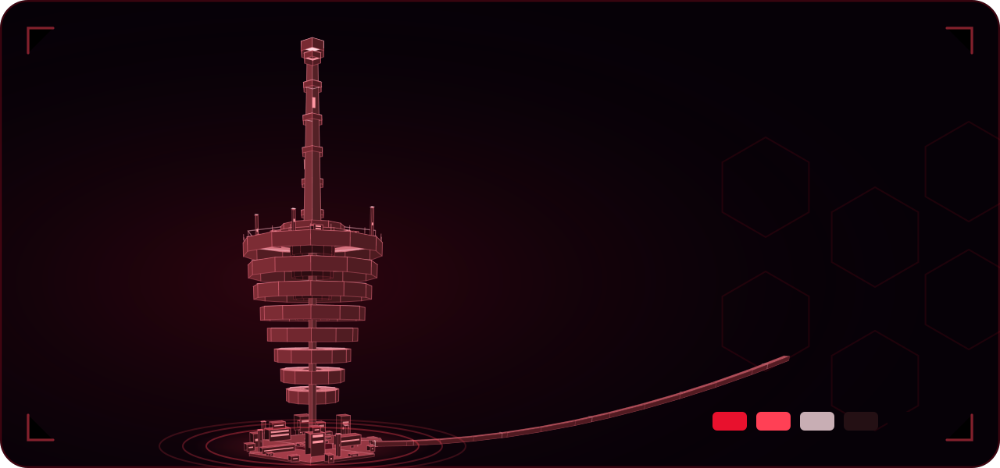

# dsh-umbrella-hive-theme

**Resident Evil: The Hive** for [DeepSeek Harness](https://github.com/deepseek-ai/deepseek-harness) — the interface becomes the facility's holographic console, with the underground Hive itself turning as a live 3D projection behind everything.



English | [中文](#中文)

## What it changes

- **A full alias-token palette.** 113 `--dsw-*` alias tokens in both schemes, plus the 11 `--shiki-*` syntax tokens, so the sidebar, composer, menus, dialogs, tooltips, diff view and code blocks all follow the theme instead of a handful of surfaces.
- **The Hive, live.** A canvas behind the whole application renders the facility as a solid model, shaped the way the film shows it: eight hexagonal decks that are widest at the crown and narrow downward, a long tapered bore rising from the crown through six collars to a lit hatch at the surface, and the sealed room cluster underneath. The sealed cluster at the bottom is the **rail terminus**: a platform, a canopy on two posts and a lit mouth, with a narrow covered bore leaving the plinth and running 6.8 units out — level where it leaves the station, then climbing as it recedes. Every deck has a lit face, a machined rim, lit windows and a honeycomb inlay. The structure is shaded by a fixed light and depth-sorted face by face, with emissive faces for the glazing; the projector pad, orbit rings and scan ring stay as wireframe light around it. The camera is flown rather than turntabled: the yaw advances at a rate that keeps slowing, stalling and briefly drifting back, the elevation sweeps a wide band from steep top-down to almost level, and a small roll banks the shot — so the facility is seen from a new side *and* a new height every few seconds, the way aerial footage circles a building. On top of that the lens breathes: two unrelated slow periods push the view back and pull it close. The pointer only nudges that flight. Still a 3D model, not a picture or a tiled wallpaper.
- **It stays out of the way.** The projection is never resized. It sits at full size to the left of the transcript whenever the space left of that column — the sidebar included — can hold it; when even that is too narrow, the monitoring console in the right band disappears and the Hive centres behind the conversation. A vignette leans toward the conversation column, the layer runs at 30 fps, pauses when the window is hidden, and stops under `prefers-reduced-motion: reduce` (one static frame is drawn instead).
- **Marks.** The Umbrella canopy — eight alternating red and light panels on a hub — as the sidebar brand mark; the Hive schematic, framed by rotating dashed rings and a scan band, in the new-session hero; and a hive-link lamp beside the account row that pulses with the link.
- **A thin HUD.** Corner brackets, a bottom hairline and a `THE HIVE / HIVE LINK ACTIVE` readout in the corner, all in red-hairline weight.
- **Crimson chrome.** The macOS New Session pill is filled with Hive red; the Chat / Trajectory tabs are borderless crimson cards with one cut corner; user bubbles, inline code, citations and menus all sit on the same near-black red palette.
- **Dark and light.** Both schemes draw the same solid model; only the sheet under it changes. Dark is the control room — near-black surfaces, a 24% sheet, crimson masses lit from one side. Light is the sealed lab — warm ivory page, near-black prose, a 20% sheet, so the same geometry reads as a rose-toned object with real volume. Panels, cards, menus and the right-hand pane stay opaque in both schemes: only the conversation column is meant to show the Hive through it.

## How the backdrop works

The Hive is a plain `<canvas>` in a fixed, `z-index: -1` decorative layer inside `#root` — inside, because the shell marks every other body child `-webkit-app-region: no-drag`, which would turn a full-window backdrop into a dead zone for the title-bar drag. Every face is projected by hand: yaw about the vertical axis, a fixed downward pitch, then a perspective divide. Each deck is a hexagonal annulus split into twelve sectors, with an outer rim wall and an inner shaft wall; faces are shaded from a fixed light direction in camera space, fogged by depth, then painted far-to-near, with the panel lines and honeycomb inlay in the same sorted list so nearer decks occlude them correctly. Two details keep that painter's order honest: the mast is cut into short segments, because one full-height face carries a single averaged depth and would sort in front of the decks that should hide it; and every lit window strip is given a small depth bias so it stays in front of the wall it is painted on instead of flickering against it. The projector pad's rings and ticks are the same projection at model height zero, so the whole scene shares one camera.

Only one thing in this theme writes outside the slot tree: that backdrop element, because `shell.overlay` is a `z-index: 20` layer *above* the application and a backdrop cannot be built there. It is pointer-transparent, `aria-hidden`, and removed with its effect.

## Install

```sh
dsh plugin --profile <profile> add dsh-umbrella-hive-theme
```

In the Web UI, use **Plugins → Add plugin** and give the absolute path to this directory. Requires DSH `>=0.2.1-rc.1 <0.3.0-0`.

> This is a full theme: install **one** theme at a time. Two themes that both override the same alias tokens and register the same brand slots may fight; disable the other one in **Plugins** before enabling this.

## Appearance

Switch the app's Appearance setting to change scheme; the theme carries both. Dark keeps the Hive visible behind the conversation; light drops the projection to a faint red schematic on ivory and keeps the crimson for marks, buttons and tabs.

## Performance notes

The backdrop is capped at 30 fps and at 2× device pixel ratio. About 450 faces are built, sorted and painted per frame — small shapes, no images and no per-frame layout work — and the render loop stops when the document is hidden or when reduced motion is requested.

## Disclaimer

Unofficial fan work. *Resident Evil*, *The Hive* and *Umbrella Corporation* are the intellectual property of Capcom. This theme is not affiliated with, endorsed by, or licensed by Capcom, and it bundles none of their assets: the facility here is a schematic re-creation drawn from geometry in this repository's code, not a film still or a game asset. MIT covers the source code only.

## License

MIT — see [LICENSE](LICENSE).

---

## 中文

《生化危机：蜂巢》，为 [DeepSeek Harness](https://github.com/deepseek-ai/deepseek-harness) 而做——整个界面变成蜂巢地下设施的全息控制台，背后是那座地下蜂巢本身，以实时渲染的 3D 模型按航拍式机位缓慢环绕。


### 主题做了什么

- **完整调色板覆盖**：深浅两套外观各覆盖 113 个 `--dsw-*` 别名 token，外加 11 个 `--shiki-*` 语法 token。侧边栏、输入框、菜单、弹窗、提示、diff 视图、代码块全部跟随主题，而不是只改几个面。
- **活的蜂巢**：整页背后是一块 canvas，把整座设施当**实体模型**渲染，并按电影里的形状来做：八层六边形甲板**上大下小**、越往下越收窄；最上面一条锥形长竖井穿过六道环箍，一直通到地表那个亮着的舱口；底部是密封舱室群，而它就是**铁路终点站**——月台、两根立柱撑起的雨棚、发亮的站口，一条窄而长的隧道从基座伸出、六点八个模型单位一路扎进黑暗，离站时水平、随后逐渐爬升。每层甲板都有受光的顶面、机加工边缘、亮着的舱窗和蜂窝嵌板。模型按固定光源做明暗、按深度逐面排序绘制，亮窗等自发光面不受光向影响；投影台、轨道环、扫描环才是线框光。镜头是按**航拍**来飞的，不是转台：偏航持续前进但时快时慢、会短暂停顿甚至微微回摆；俯仰角在很大的范围内来回扫（从近乎垂直俯瞰到接近平视）；再加一点点横滚把画面「压」一下。所以每隔几秒就能从一个新的侧面、新的高度看到这座设施，像航拍绕着建筑转。镜头还会**推拉**：两条互不相关的慢周期让它时而后退、时而贴近。鼠标只会让这条航线轻微偏离。仍然是 3D 模型，不是图片，也不是平铺壁纸。
- **不抢正文**：投影从不缩放：只要对话栏左侧（含侧边栏）放得下，就以原尺寸待在左侧；放不下时收掉右侧监控台装饰，把蜂巢居中到对话栏后面。整体向对话栏方向压暗；背景 30fps 渲染、窗口隐藏即暂停，`prefers-reduced-motion: reduce` 下只画一帧静态图。
- **徽记**：侧栏品牌位是**保护伞伞面**——八片红白相间的伞叶汇聚在轴心上；新建会话页是蜂巢设施的完整示意图，外围套着旋转虚线环与扫描带；账户行旁是一枚随链路呼吸的蜂巢指示灯。
- **克制的 HUD**：四角红色细线括号、底部一条极细光线，以及角落里 `THE HIVE / HIVE LINK ACTIVE` 的等宽小字。
- **绯红的控件**：macOS 的 New Session 按钮填满蜂巢红；Chat / Trajectory 标签是无边框、切一个角的绯红卡片；用户气泡、行内代码、引用、菜单都落在同一套近黑红配色上。
- **明暗双外观**：两套画的是**同一个实体模型**，只是底下的薄片不同。暗色是控制室——近黑表面、24% 深色薄片、单侧打光的绯红体块；浅色是密闭实验室——暖白页面、近黑正文、20% 浅色薄片，同一套几何呈现为有体积的玫瑰色物体。面板、卡片、菜单和右侧栏在两种外观下都保持不透明：只有对话区才应该透出蜂巢。

### 背景是怎么做的

蜂巢是 `#root` 内部一个 `z-index: -1` 的固定装饰层里的一块普通 `<canvas>`。放进 `#root` 内部，是因为壳层会把所有其它 body 直接子元素标成 `-webkit-app-region: no-drag`，整窗背景放在 body 下会让标题栏拖拽失效。每一个面都手工投影：绕竖轴偏航、固定俯角，再做透视除法。每层甲板是一个六边形环带、切成 12 个扇区，带外侧轮缘与内侧竖井壁；面按相机空间里的固定光向做明暗、按深度做雾化，再由远及近逐面绘制，面板线与蜂窝嵌板也放进同一个排序列表，因此会被更近的甲板正确遮挡。投影台的环与刻度用的是模型高度为零时的同一套投影，所以整个场景共用一个相机。

这个主题只有一处写在槽位树之外：就是这层背景——因为 `shell.overlay` 是盖在应用之上、`z-index: 20` 的层，背景放在那里只会盖住界面。它不接收指针事件、`aria-hidden`，并随 effect 一起移除。

### 安装

```sh
dsh plugin --profile <profile> add dsh-umbrella-hive-theme
```

也可以在 Web 界面 **Plugins → Add plugin** 里填这个目录的绝对路径。要求 DSH `>=0.2.1-rc.1 <0.3.0-0`。

> 这是整套主题：**一次只装一个**。两个同时覆盖同一批别名 token、又抢占同一批品牌槽位的主题会互相打架，启用本主题前请在 **Plugins** 里停用另一个。

### 免责声明

非官方粉丝作品。*生化危机*、*蜂巢* 与 *保护伞公司* 的知识产权属于 Capcom。本主题与 Capcom 无隶属、背书或授权关系，也不包含其任何素材——这里的设施是本仓库代码中用几何图形绘制的示意图，不使用电影剧照或游戏素材。MIT 仅覆盖源码。